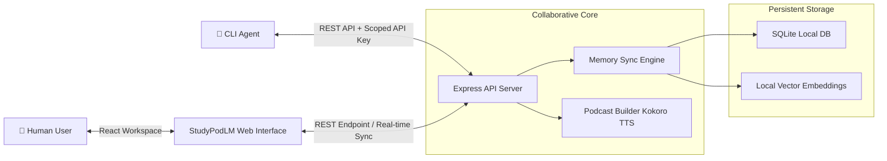

# StudyPodLM: Human-Agent Collaborative Study Engine

<div align="center">


StudyPod lets you ask questions about your sources, check the passage behind an answer, and listen to your material as a podcast or a narrated chapter. You can also give an agent scoped access to a notebook.

[](https://studypod-lm.vercel.app/)
[](https://github.com/SantanDon/studypod)
[](LICENSE)

[Explore Deployed App](https://studypod-lm.vercel.app/) • [Set Up Local Development](#1-initialize-the-workspace) • [Report Issue](https://github.com/SantanDon/studypod/issues)

</div>

## Try a notebook

1. Sign in, create a notebook, and add a text source. You can use this sample field note.

   ```text
   The survey begins at noon.
   The spare spectrometer is stored in the amber cabinet.
   ```
2. In **Study Chat**, ask “Where is the spare spectrometer stored?” Open the citation beside the answer. The source should open with the sentence about the amber cabinet highlighted.
3. Open **Studio → Podcast → Set up podcast**. Pick your episode settings, choose **Create podcast**, and keep the tab open while the hosted recording is made. Play the saved episode or download it.
4. For a reading in the source’s original words, open **Studio → Audiobook**. Choose the source and part, then **Generate chapter audio**. Return to the same notebook and choose **Open saved recording** to listen again. Full-book EPUB generation runs in the local installation.

---

## 🌟 The Vision: Collaborative Memory Loop

Traditionally, AI assistants operate in transient chat sessions. Once closed, the context is lost. **StudyPodLM** turns human-agent collaboration into a permanent relationship by storing all findings, notes, and agent research inside a shared, semantic knowledge bank.



> [!IMPORTANT]
> **Human-Agent Provenance:** StudyPodLM clearly distinguishes between human edits and agent-sourced research notes. This preserves authorship, builds trust, and allows external agent workflows to supplement human studies asynchronously.

---

## 🚀 Key Highlights

| Feature | For Humans | For Autonomous Agents |
| :--- | :--- | :--- |
| **Workspace Sync** | 📚 Read files, capture notes, compile resources | 🤖 Fetch real-time notebook snapshots and read sources |
| **Audio Overviews** | 🎧 Generate multi-speaker podcasts via Kokoro TTS | 📻 Schedule podcast generation runs asynchronously |
| **Interactive Study** | 🧩 Take flashcards & quizzes derived from your context | 🧠 Populate notes and study material from agent findings |
| **Decentralized Auth** | 🔑 Key Pair and Scoped Identity Primitives | 🛰️ Exchange pairing PINs for scoped API keys |

---

## 📂 Project Architecture

```bash
studylm/
├── agent_demo_kit/    # 🤖 CLI Agent Tools & Setup templates
├── api/              # 🌐 Serverless functions for edge deployment
├── backend/          # ⚙️ Collaborative Server (Express + Local DB)
│   ├── scripts/      # 🛠️ Administrative & bootstrapping utilities
│   └── src/          # 🏗️ Core Auth, Notebooks, and Memory services
├── src/              # 🎨 Frontend Web UI (React + Tailwind CSS)
└── docs/             # 📖 Detailed Guides & Security Auditing
```

---

## 🚦 Quick Start

### 1. Initialize the Workspace

Install Node.js 22 and npm, then clone the repository.

```bash
git clone https://github.com/SantanDon/studypod.git
cd studypod
npm install
```

The install hook installs the Express backend dependencies. If CI mode is enabled, run `npm --prefix backend ci` explicitly.

Create an untracked `.env` in the repository root with the following local database and proxy settings.

```dotenv
TURSO_DATABASE_URL=file:studypod-local.db
VITE_API_PORT=4000
PORT=4000
```

Generate a local signing secret using the command below and add its output as `JWT_SECRET` in `.env`. Keep that file local. The file-backed database can run without a Turso account.

```bash
node -e "console.log(require('node:crypto').randomBytes(32).toString('hex'))"
```

After saving the secret in `.env`, start the frontend and backend.

```bash
npm run dev
```

Open [the local app](http://127.0.0.1:5173). Sign in with a local account before pairing an agent.

### Verify a change

```bash
npm run typecheck
npm run lint
npm test -- --run
npm run test:gate:unit
npm run build
```

For browser changes, install Chromium with `npx playwright install chromium`, then run `npm run test:e2e` and `npm run test:auth:local` as applicable. The [quality workflow](.github/workflows/quality.yml) lists the full CI checks. Include reproduction steps and verification results when opening an issue or pull request.

### 2. Connect Your First CLI Agent

To plug in a custom command-line assistant (e.g., Qwen, Gemini, Llama):
1. Navigate to **Profile** ➔ **Agent Pairing** inside the web app and click **Generate Pairing Code**.
2. Use the 6-digit code to verify pairing:
   ```bash
   node agent_demo_kit/pair_and_test.js <YOUR-6-DIGIT-PIN>
   ```
3. The script creates a demo key that expires after one hour, verifies identity, and reports the number of accessible notebooks. It keeps the key in memory and makes no notebook changes by default. To create a sample note in a specific test notebook, add `--write-note <NOTEBOOK-ID>`.

---

## 🛡️ Security & Privacy First

StudyPod uses browser storage for local notebook data. Signed-in features also use the StudyPod backend to store and retrieve notebook records. When you select a hosted AI provider, it receives the inputs needed for that request, which may include source excerpts.

Closing a private browsing session can erase its local data. Export any notebooks you want to keep before closing the window. Keep provider keys and agent credentials out of shared notebooks, exports, and Git commits.

---

## 📖 Essential Documentation

| Document | Purpose |
| :--- | :--- |
| [Agent Onboarding Protocol](AGENTS.md) | Full technical manual on pairing API keys & Posting insights |
| [Headless Agent API](public/API_HEADLESS.md) | REST API endpoint documentation with raw cURL examples |
| [Security Audit & Review](docs/SECURITY_AUDIT.md) | Assessment of sanitization passes & system security posture |
| [Guest Mode Architecture](docs/GUEST_MODE.md) | Deep dive into offline encryption and browser databases |
| [YouTube Extraction Guide](docs/YOUTUBE_COOKIE_GUIDE.md) | Bypass Bot detection using browser cookies for YouTube extraction |

---

<div align="center">

**Built for the future of collaborative intelligence.**  
*Developed with ❤️, powered by Antigravity*

</div>
